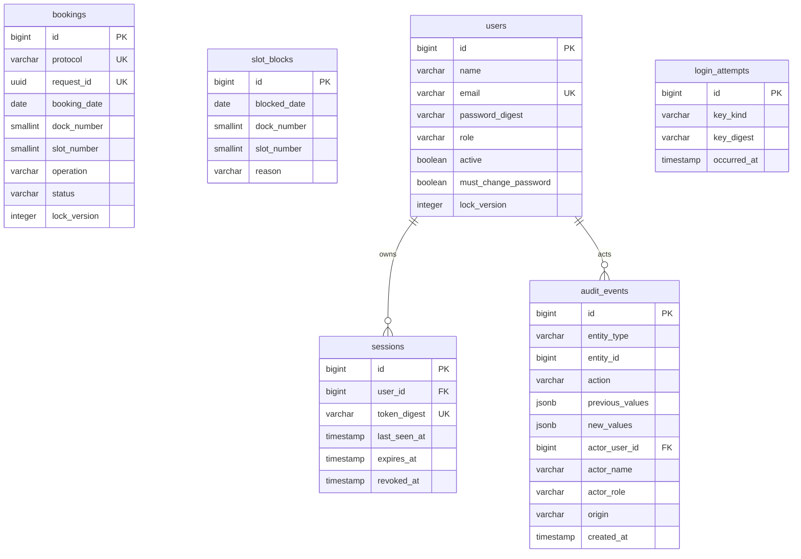

# Estrutura — RF002 a RF016

Esta documentação descreve a estrutura acumulada até o RF016. O snapshot executável atual é `db/structure.sql`, gerado pelo Rails e ampliado no RF011 com a proteção append-only.

## Diagrama

As foreign keys ligam sessões e atores de auditoria a `users`, com exclusão restrita. A relação `audit_events.(entity_type, entity_id)` continua sendo referência genérica, sem garantia referencial. As proteções de posição em bookings e slot_blocks são independentes.

## bookings

| Coluna | Tipo PostgreSQL | Obrigatória | Default |
| --- | --- | --- | --- |
| id | bigint, chave primária gerada pelo Rails | Sim | sequência da PK |
| protocol | varchar(50) | Sim | — |
| request_id | uuid | Sim | — |
| booking_date | date | Sim | — |
| dock_number | smallint | Sim | — |
| slot_number | smallint | Sim | — |
| operation | varchar(20) | Sim | — |
| status | varchar(30) | Sim | `agendado` |
| contact_name | varchar(80) | Sim | — |
| company | varchar(100) | Sim | — |
| invoice | varchar(44) | Sim | — |
| plate | varchar(7) | Sim | — |
| vehicle_model | varchar(80) | Sim | — |
| checkin_at | timestamp(6) without time zone | Não | — |
| released_at | timestamp(6) without time zone | Não | — |
| release_remark | text | Não, exceto status liberado | — |
| change_reason | text | Não | — |
| lock_version | integer | Sim | `0` |
| created_at | timestamp(6) without time zone | Sim | — |
| updated_at | timestamp(6) without time zone | Sim | — |

Timestamps são preenchidos pelo Rails e persistidos em UTC, sem default fictício de banco. `contact_name` é o responsável pelo agendamento, não necessariamente o motorista. No RF003, o protocolo é gerado no servidor e o UUID identifica a tentativa de criação idempotente. NF é string e preserva zeros à esquerda; placa aceita tanto `ABC1234` quanto `ABC1D23`, sem normalização funcional neste RF.

### Índices

| Nome | Colunas | Único | Predicado |
| --- | --- | --- | --- |
| index_bookings_on_protocol | protocol | Sim | — |
| index_bookings_on_request_id | request_id | Sim | — |
| index_bookings_on_booking_date | booking_date | Não | — |
| bookings_active_slot_unique | booking_date, dock_number, slot_number | Sim | status IN ('agendado', 'em_operacao', 'liberado') |
| bookings_dock_occupation_unique | dock_number | Sim | status = 'em_operacao' |

A PK também possui índice nativo. Não foram criados índices adicionais ou duplicados. Reservas canceladas e em reagendamento podem compartilhar a posição histórica com outras reservas; registros liberados continuam consumindo capacidade. A ocupação física independe de data e janela.

### Check constraints

| Nome | Proteção |
| --- | --- |
| bookings_dock_range | dock_number entre 1 e 8 |
| bookings_slot_range | slot_number entre 1 e 10 |
| bookings_operation_allowed | operation em entrega/coleta |
| bookings_status_allowed | status em agendado/em_operacao/liberado/cancelado/reagendamento |
| bookings_invoice_digits | invoice com 1 a 44 dígitos ASCII, expressão `^[0-9]{1,44}$` |
| bookings_lock_version_nonnegative | lock_version >= 0 |
| bookings_release_chronology | released_at nulo ou checkin_at preenchido com released_at >= checkin_at |
| bookings_operation_checkin | em_operacao exige checkin_at |
| bookings_released_details | liberado exige checkin_at, released_at e release_remark não nulos, com 3 a 500 caracteres após remover whitespace das extremidades |

A observação de liberação usa `regexp_replace` com a classe PostgreSQL `[[:space:]]` para remover espaços, tabs e quebras de linha das extremidades; o tamanho é contado por caracteres, não bytes. Campos obrigatórios usam NOT NULL além dos checks, evitando que a lógica ternária de NULL contorne a proteção. Não existem regras de compatibilidade doca/operação, datas futuras ou transições de estado.

## slot_blocks

| Coluna | Tipo PostgreSQL | Obrigatória | Default |
| --- | --- | --- | --- |
| id | bigint, chave primária gerada pelo Rails | Sim | sequência da PK |
| blocked_date | date | Sim | — |
| dock_number | smallint | Sim | — |
| slot_number | smallint | Sim | — |
| reason | varchar(250) | Não | — |
| created_at | timestamp(6) without time zone | Sim | — |
| updated_at | timestamp(6) without time zone | Sim | — |

Índice `slot_blocks_position_unique`: único em `(blocked_date, dock_number, slot_number)`, além da PK. Constraints `slot_blocks_dock_range` (1 a 8) e `slot_blocks_slot_range` (1 a 10). O limite do motivo é protegido pelo tipo varchar(250). Não há usuário ou autor associado.

## audit_events

| Coluna | Tipo PostgreSQL | Obrigatória | Default |
| --- | --- | --- | --- |
| id | bigint, chave primária gerada pelo Rails | Sim | sequência da PK |
| entity_type | varchar(50) | Sim | — |
| entity_id | bigint | Sim | — |
| action | varchar(50) | Sim | — |
| previous_values | jsonb | Não | — |
| new_values | jsonb | Não | — |
| reason | text | Não | — |
| created_at | timestamp(6) without time zone | Sim | — |
| actor_user_id | bigint, foreign key para users | Não | — |
| actor_name | varchar(100) | Não | — |
| actor_role | varchar(30) | Não | — |
| origin | varchar(30) | Não | — |

Índices cobrem `(entity_type, entity_id)`, `actor_user_id` e `origin`. A constraint de entidade permite `Booking`, `SlotBlock` e `User`; origem e perfil do ator usam listas fixas. Quando existe ator, ID, nome e perfil são obrigatórios em conjunto. Campos JSONB armazenam valores nativos, não JSON serializado em text. Não há updated_at ou foreign key para a referência genérica. Eventos anteriores ao RF016 permanecem sem ator.

Desde o RF011, o trigger `audit_events_append_only` impede UPDATE e DELETE, inclusive por Active Record em lote e SQL direto, sem impedir INSERT/SELECT. A criação dos eventos continua nos services e nas transações de negócio. O snapshot SQL preserva função e trigger em novas instalações. Proprietários/superusuários ainda podem remover a proteção ou executar operações estruturais como TRUNCATE; ela não substitui controles de acesso ao banco. Consulte a ADR 0014 e o procedimento de manutenção no README deste diretório.

## users — RF015

| Coluna | Tipo PostgreSQL | Obrigatória | Default |
| --- | --- | --- | --- |
| id | bigint, chave primária gerada pelo Rails | Sim | sequência da PK |
| name | varchar(100) | Sim | — |
| email | varchar(254) | Sim | — |
| password_digest | varchar | Sim | — |
| role | varchar(30) | Sim | — |
| active | boolean | Sim | `true` |
| must_change_password | boolean | Sim | `true` |
| password_changed_at | timestamp(6) without time zone | Não | — |
| deactivated_at | timestamp(6) without time zone | Não | — |
| lock_version | integer | Sim | `0` |
| created_at / updated_at | timestamp(6) without time zone | Sim | — |

O índice único funcional `users_email_unique` usa `lower(email)`. Checks limitam perfil a `admin`, `operator` ou `viewer`, exigem identidade não vazia, mantêm `active` consistente com `deactivated_at` e impedem versão negativa. A validação Rails normaliza e-mail para minúsculas e espaços externos. A aplicação serializa mutações administrativas com advisory lock e controle otimista; SQL direto que ignore esse protocolo não recebe a proteção de último administrador. Senhas são BCrypt; o digest nunca entra em snapshots de auditoria.

## sessions — RF016

| Coluna | Tipo PostgreSQL | Obrigatória | Default |
| --- | --- | --- | --- |
| id | bigint, chave primária | Sim | sequência da PK |
| user_id | bigint, foreign key para users | Sim | — |
| token_digest | varchar(64) | Sim | — |
| last_seen_at | timestamp(6) without time zone | Sim | — |
| expires_at | timestamp(6) without time zone | Sim | — |
| revoked_at | timestamp(6) without time zone | Não | — |
| user_agent | varchar(500) | Não | — |
| created_at / updated_at | timestamp(6) without time zone | Sim | — |

`token_digest` possui índice único; `user_id`, `expires_at` e `revoked_at` possuem índices de consulta. Checks exigem digest hexadecimal de 64 posições e expiração posterior à criação. O banco nunca recebe o token original.

## login_attempts — RF016

| Coluna | Tipo PostgreSQL | Obrigatória | Default |
| --- | --- | --- | --- |
| id | bigint, chave primária | Sim | sequência da PK |
| key_kind | varchar(10) | Sim | — |
| key_digest | varchar(64) | Sim | — |
| occurred_at | timestamp(6) without time zone | Sim | — |

Checks aceitam somente `email` ou `ip` e digest de 64 posições. Índices em `(key_kind, key_digest, occurred_at)` e `occurred_at` atendem contagem e limpeza.

## Limitações obrigatórias antes dos fluxos operacionais

Os índices únicos parciais garantem capacidade e ocupação física **dentro de bookings**. O índice de slot_blocks garante bloqueios únicos **dentro de slot_blocks**. Nenhum deles impede reserva ativa e bloqueio simultâneos na mesma posição entre as duas tabelas. O RF003 adota trava transacional compartilhada na criação. Futuros escritores de capacidade deverão usar o mesmo protocolo; gravações que o ignorem continuam sem essa garantia entre tabelas.

Não há tabelas de docas/janelas ou permissões dinâmicas. Sessões e tentativas possuem retenção técnica; não há expurgo de usuários ou do histórico operacional. A estratégia de persistência continua sendo o volume `postgres_data`, sem exposição pública do PostgreSQL; detalhes e comandos estão no [README do banco](README.md).
