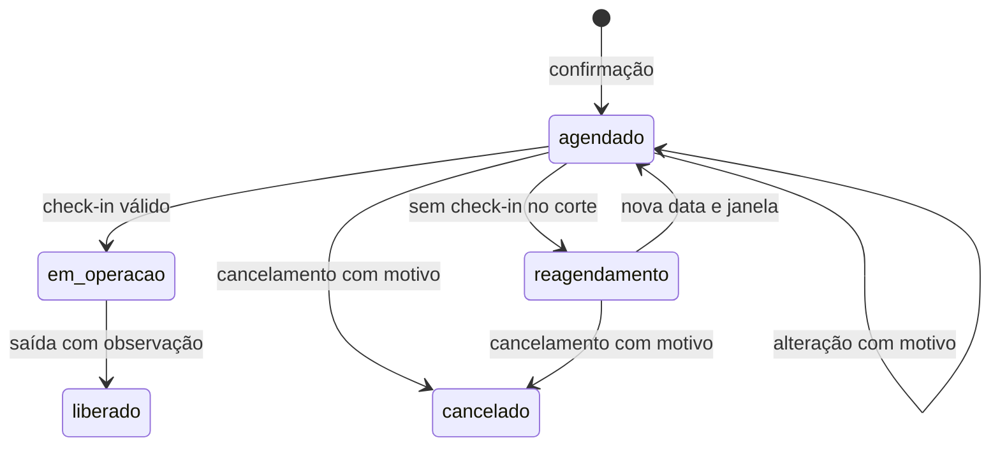

# DSV Doca Agenda — Especificação funcional e técnica

**Finalidade:** passagem do protótipo para desenvolvimento e evolução em servidor próprio.  
**Responsável pelo produto:** Tilgate Rodrigues — Senior Manager / especialista em logística.  
**Documento:** versão 1.0 — 24/11/2026.  
**Referência técnica:** versão publicada 6; código conferido no commit `a43fd3628b5d86509b0d08076aee3ad01fbad793`.  
**Idioma:** português do Brasil. **Fuso operacional:** `America/Sao_Paulo`.

> **Alteração mais recente de escopo:** o usuário retirou a necessidade de apagar os dados após três dias. A solução em servidor próprio deverá preservar os agendamentos e seu histórico, sem expurgo automático de 72 horas. O limite de três dias para escolher uma data de agendamento continua válido. A validade dos links é uma terceira regra, ainda a definir.

## 1. Objetivo e leitura deste documento

Sistema B2B para agendar entregas e coletas e acompanhar a utilização de sete docas físicas. Transportadoras recebem um link pelo WhatsApp, preenchem o formulário no celular e recebem um comprovante com QR Code. A equipe autorizada acompanha e controla a operação em um painel web.

Este documento distingue três situações:

- **Implementado:** comportamento verificado no código da versão 6.
- **Solicitado / pendente:** necessidade apresentada pelo usuário que ainda não está implementada ou depende de uma definição.
- **Proposta técnica:** recomendação para a próxima implementação; não deve ser tratada como decisão já aprovada pelo usuário.

A solução atual possui interface web responsiva e servidor com banco de dados compartilhado. Não é um HTML isolado com armazenamento local, nem um aplicativo nativo Android/iOS. A atualização entre usuários depende da conexão com o servidor.

### 1.1 Endereços da versão de teste

| Uso | Endereço |
| --- | --- |
| Formulário público | https://doca-agenda-teste.tilgate.chatgpt.site/agendar |
| Painel do gestor | https://doca-agenda-teste.tilgate.chatgpt.site/painel |
| Configuração privada do Gmail | https://doca-agenda-teste.tilgate.chatgpt.site/painel/gmail |

Esses endereços são referências do protótipo. O domínio definitivo ainda será informado. Receber o endereço do painel não concede permissão para consultá-lo.

### 1.2 Resumo do escopo

| Funcionalidade | Situação |
| --- | --- |
| Formulário para celular e painel web compartilhando os dados | Implementado |
| Sete docas e dez janelas por dia | Implementado |
| Três docas de recebimento e quatro de expedição | Implementado |
| Reserva para hoje e os próximos dois dias | Implementado |
| NF, placa e modelo do veículo | Implementado |
| Nome do responsável e empresa/transportadora | Implementado |
| Dados de motorista separados do responsável pelo agendamento | Solicitado; falta definir os campos e implementar |
| Alteração, cancelamento, check-in e liberação com observação | Implementado no painel do gestor |
| Bloqueio de múltiplas docas e janelas | Implementado |
| QR Code com destino DSV, operação, data, doca e horário | Implementado como comprovante textual |
| Notificação de nova reserva para quatro destinatários | Implementado; recebimento confirmado pelo usuário na fase de teste |
| Exportação XLSX em colunas, sem mesclagem | Implementado |
| Exclusão dos dados após três dias | Requisito retirado em 24/11/2026; não implementar |
| Histórico persistente no servidor próprio | Requisito vigente para a evolução |
| Envio consolidado de dados por e-mail a cada três dias | Pedido anterior ainda não implementado; confirmar se continua necessário sem a exclusão |
| Outros usuários autorizados no painel | Solicitado; perfis e usuários ainda não cadastrados |
| Links com validade | Solicitado; tipo de link e prazo ainda não definidos |
| Numeração definitiva das docas | Pendente de mapeamento do usuário |
| Domínio próprio e migração de hospedagem/autenticação | Etapa futura solicitada |
| Aplicativo nativo e GPS/geofencing | Escopo inicial; não implementado no protótipo |

## 2. Capacidade, calendário e horários

### 2.1 Distribuição das docas

| Doca atual | Operação padrão no formulário |
| --- | --- |
| 01 | Entrega / recebimento |
| 02 | Entrega / recebimento |
| 03 | Entrega / recebimento |
| 04 | Coleta / expedição |
| 05 | Coleta / expedição |
| 06 | Coleta / expedição |
| 07 | Coleta / expedição |

- Uma reserva por combinação **data + doca + janela**.
- Capacidade nominal: **70 reservas/dia**, sendo 30 de recebimento e 40 de expedição na distribuição padrão.
- Capacidade física simultânea: **sete veículos em operação**, no máximo um por doca.
- A distribuição 3/4 é o padrão permanente. Uma exceção autorizada não muda automaticamente a classificação da doca.
- O gestor pode transferir uma entrega para uma doca de expedição, ou o inverso, mediante confirmação explícita e motivo registrado.
- Cancelamentos e reagendamentos podem produzir mais de 70 registros históricos em uma data. O limite de capacidade considera as reservas que consomem slots, não o total de linhas do histórico.

### 2.2 Matriz de janelas

| Janela | Início | Fim | Duração | Capacidade nominal |
| --- | --- | --- | --- | --- |
| 1 | 08:00 | 09:00 | 60 min | 7 |
| 2 | 09:00 | 10:00 | 60 min | 7 |
| 3 | 10:00 | 11:00 | 60 min | 7 |
| 4 | 11:00 | 12:00 | 60 min | 7 |
| 5 | 12:00 | 13:00 | 60 min | 7 |
| 6 | 13:00 | 14:00 | 60 min | 7 |
| 7 | 14:00 | 15:00 | 60 min | 7 |
| 8 | 15:00 | 16:00 | 60 min | 7 |
| 9 | 16:00 | 17:00 | 60 min | 7 |
| 10 | 17:00 | 17:48 | 48 min | 7 |

O encerramento da operação é **17:48**. A janela 10 não termina às 18:00.

### 2.3 Horizonte para criar ou alterar uma reserva

**Regra implementada:** permitir somente a data de hoje, amanhã e depois de amanhã, calculadas pelo servidor no fuso de São Paulo.

Exemplo: em 24/11/2026, as datas permitidas são 24, 25 e 26/11/2026. Isso representa três datas de calendário, não 72 horas corridas nem hoje mais três dias.

- Para o dia atual, a janela precisa estar **estritamente no futuro**: `início_da_janela > horário_atual`.
- Exemplo: às 10:00, não é possível criar uma nova reserva para 10:00–11:00.
- A janela das 17:00 precisa ser reservada antes das 17:00. O corte de check-in às 17:30 não estende o prazo para criar essa reserva.
- A partir das 17:00, o protótipo sugere o dia seguinte como data inicial.
- O gestor pode consultar e exportar datas anteriores, independentemente do horizonte de novas reservas.
- O protótipo não possui calendário de feriados, fins de semana ou dias não operacionais. Se houver restrições por dia da semana, deverão ser informadas e implementadas; não presumir uma escala de outra operação.

### 2.4 Corte de entrada às 17:30

**Regra rígida:** bloquear check-in a partir de `17:30:00`, inclusive para quem possui reserva na última janela.

Condições verificadas no servidor para aceitar check-in:

1. A reserva está em `agendado`.
2. A data atual é a data da reserva.
3. O horário atual é igual ou posterior ao início da janela.
4. O horário atual é igual ou posterior a 08:00 e anterior a 17:30.
5. Não existe outro veículo em `em_operacao` na mesma doca.
6. A versão do registro ainda corresponde à versão consultada pelo operador.

Às 17:29, o check-in pode passar por essas validações. Às 17:30, deve ser recusado. A liberação de um veículo já em operação continua disponível para registrar o horário real de saída, inclusive se a operação ultrapassar o expediente.

**Limitação relevante:** os 18 minutos entre 17:30 e 17:48 representam o intervalo mínimo solicitado para encerramento/liberação do pátio. O protótipo não calcula duração de descarga/carga, nem garante que qualquer operação iniciada pouco antes do corte termine às 17:48. Uma avaliação por duração ou tipo de veículo seria uma regra adicional.

### 2.5 No-show e atraso

- A partir das 17:30, reservas do dia ainda em `agendado` passam para `reagendamento`.
- Reservas de dias anteriores ainda em `agendado` também passam para `reagendamento`.
- Isso inclui a janela 10 e as demais janelas do dia que permaneceram sem check-in.
- A reserva e seus dados são preservados para consulta e ação do gestor.
- Um motorista da janela 10 que chega após o corte não pode entrar por exceção informal; o gestor deve reagendar para uma janela futura válida.

**Mecanismo atual:** atualização executada nas consultas e ações da API, por `closeNoShows()`. Não há tarefa independente que rode exatamente às 17:30 quando ninguém acessa o site. A tentativa de check-in também valida o corte, portanto uma tela antiga não permite entrada fora do horário.

**Comportamento atual de atraso antes do corte:** o fim de uma janela anterior, sozinho, não converte a reserva em no-show. Uma reserva atrasada pode receber check-in antes das 17:30, desde que a doca esteja livre. A regra de tolerância por janela deve ser definida se for necessário restringir esse comportamento.

**Proposta técnica:** adicionar uma tarefa de servidor para atualizar no-shows no horário do corte, mantendo a validação obrigatória em cada ação. Não depender de navegador aberto.

## 3. Formulário de agendamento no celular

### 3.1 Jornada

1. A transportadora recebe o link pelo WhatsApp.
2. Informa responsável, empresa, operação, NF e veículo.
3. Escolhe uma das três datas permitidas.
4. Seleciona uma doca compatível e uma janela disponível.
5. Confirma a reserva.
6. O servidor verifica novamente todas as regras e grava a reserva.
7. O sistema mostra protocolo e comprovante com QR Code.
8. A reserva aparece no painel e o servidor tenta enviar a notificação por e-mail.

O compartilhamento pelo WhatsApp é feito pelo usuário. Não existe integração de envio automático com a API do WhatsApp no protótipo.

### 3.2 Campos e validações atuais

| Campo de negócio | Campo da API / banco | Regra atual |
| --- | --- | --- |
| Responsável pelo preenchimento | `name` | Obrigatório; 2–80 caracteres |
| Empresa / transportadora | `company` | Obrigatório; 2–100 caracteres |
| Operação | `operation` | `entrega` ou `coleta` |
| Número da NF | `invoice` | Obrigatório; texto numérico de 1–44 dígitos; preservar zeros à esquerda |
| Placa | `plate` | Placa brasileira; aceitar padrão antigo e Mercosul; remover espaços/hífen e converter para maiúsculas |
| Modelo do veículo | `vehicleModel` / `vehicle_model` | Obrigatório; 2–80 caracteres |
| Data | `date` / `booking_date` | Data válida `YYYY-MM-DD`, dentro do horizonte |
| Doca | `dock` | Inteiro 1–7, compatível com a operação |
| Janela | `slot` | Inteiro 1–10, futura, disponível e sem bloqueio |
| Identificador da tentativa | `requestId` / `request_id` | UUID v4 para impedir duplicidade ao repetir a mesma confirmação |

O campo `name` é o responsável por agendar; **não equivale automaticamente ao motorista**. Para cumprir o escopo completo, separar `driver_name` de `name`. Telefone, documento, CNH e outros dados não foram definidos como campos finais e não devem ser inventados como obrigatórios.

A NF atual é um único texto numérico. O limite de 44 dígitos não significa que exista validação fiscal de chave NF-e. Definir separadamente se a versão final receberá número de NF, chave de acesso ou múltiplas notas por veículo.

### 3.3 Confirmação e concorrência

- A tela de disponibilidade é informativa; a decisão final ocorre no servidor e no banco.
- Duas pessoas disputando o mesmo slot não podem receber confirmação para a mesma combinação.
- Repetir uma solicitação com o mesmo `requestId` e conteúdo equivalente retorna a reserva existente.
- Reutilizar a solicitação com conteúdo incompatível gera conflito.
- Em conflito, atualizar a disponibilidade e pedir outra doca/janela sem apagar os dados preenchidos.
- Falha no e-mail não cancela uma reserva gravada com sucesso.
- O formulário público não expõe dados de outras reservas, motivos internos de bloqueio nem configurações de e-mail.

## 4. Painel principal e fluxo operacional

### 4.1 Visualização

- Matriz com sete linhas de docas e dez colunas de janelas.
- Seletor de data.
- Indicadores de agendamentos, slots ainda reserváveis, entregas e coletas.
- Lista dos registros da data, incluindo cancelados e pendentes de reagendamento.
- Detalhes da reserva, histórico de alterações e ações permitidas para seu status.
- Acesso à exportação, avisos por e-mail, compartilhamento do formulário e bloqueio de janelas.
- Atualização automática a cada cinco segundos enquanto a página está visível, e ao voltar para a página.
- Indicação de falha de atualização; não apresentar dados antigos como confirmação de disponibilidade atual.

O painel da versão 6 é restrito ao proprietário configurado. Os perfis adicionais da seção 10 ainda não existem.

### 4.2 Estados da reserva

| Estado no banco | Exibição | Significado | Consome o slot reservado? |
| --- | --- | --- | --- |
| `agendado` | Agendado | Reserva confirmada, sem check-in | Sim |
| `em_operacao` | Em operação | Check-in registrado, doca ocupada | Sim |
| `liberado` | Doca liberada | Operação encerrada com horário e observação | Sim, para manter uma reserva por slot |
| `cancelado` | Cancelado | Reserva cancelada, dados preservados | Não |
| `reagendamento` | Reagendamento obrigatório | Sem check-in até o corte ou data vencida | Não |

**Liberar a doca fisicamente não reabre a mesma janela para uma segunda reserva.** Isso mantém a capacidade de uma reserva por doca/janela. Cancelar ou reagendar devolve o slot anterior, mas uma janela já iniciada continua indisponível para nova reserva.



### 4.3 Alteração e cancelamento

- Permitidos ao gestor para reservas em `agendado` ou `reagendamento`.
- Motivo obrigatório, com 3–500 caracteres.
- Nova combinação deve estar dentro do horizonte, no futuro, livre e desbloqueada.
- Para trocar para uma doca de outra operação, exigir `allowOverride: true` e registrar o motivo.
- Alterar a doca não modifica o tipo de operação da reserva.
- Incrementar `version` e auditar a mudança.
- Duas pessoas operando sobre a mesma versão não podem sobrescrever alterações silenciosamente.
- O participante externo ainda não possui edição/cancelamento por conta própria; deve procurar o gestor.
- Alterações e cancelamentos não disparam novos e-mails automaticamente na versão atual.

### 4.4 Check-in e liberação

- O check-in atual é uma ação manual do gestor.
- Registrar `checkin_at` com relógio do servidor e mudar para `em_operacao`.
- Antes do check-in, verificar a ocupação física da doca, inclusive uma operação atrasada de outra janela.
- Para liberar, a reserva deve estar em `em_operacao`.
- Exigir observação da liberação com 3–500 caracteres.
- Gravar `released_at` e `release_remark`; mudar para `liberado`.
- O horário de liberação da doca representa o registro operacional atual. Não existe um segundo evento independente de saída na portaria; criá-lo somente se esse controle for requerido.

### 4.5 Alerta de ocupação excedida

- Quando `status = em_operacao` e o horário atual alcança o fim da janela, destacar visualmente a reserva como atraso na doca.
- A última janela gera atraso a partir das 17:48.
- A versão atual usa destaque pulsante, respeitando a preferência de redução de movimento do dispositivo.
- O atraso não encerra automaticamente a operação nem libera a doca.

## 5. Bloqueio de janelas pelo master

Funcionalidade já implementada na tela principal.

1. Selecionar a data do painel.
2. Marcar uma ou mais docas.
3. Marcar uma ou mais janelas.
4. Informar motivo interno opcional, até 250 caracteres.
5. Executar **Bloquear** ou **Desbloquear**.

Regras:

- A seleção representa todas as combinações de docas × janelas.
- Exemplo: três docas e duas janelas produzem seis posições selecionadas.
- Só podem ser bloqueadas/desbloqueadas janelas futuras, dentro do horizonte de três datas.
- Se qualquer posição da seleção já tiver reserva que consome o slot, recusar o bloqueio inteiro. Não cancelar a reserva e não aplicar parcialmente.
- Repetir o mesmo bloqueio não cria duplicidade.
- Desbloquear remove apenas os bloqueios existentes da seleção.
- Reservar ou reagendar em slot bloqueado deve falhar também no banco, mesmo com tela antiga.
- Registrar quem bloqueou/desbloqueou, data/hora, posições e motivo.
- No formulário público, mostrar apenas a indisponibilidade; os detalhes internos ficam restritos.
- Bloquear ou desbloquear não envia e-mail de agendamento.

## 6. QR Code e comprovante

### 6.1 Conteúdo atual

Exemplo ilustrativo:

```text
DSV - DOCA AGENDA
Destino: DSV
Operacao: Entrega / recebimento
Protocolo: DA-EXEMPLO001
Data: 25/11/2026
Doca: 01
Horario: 08:00 - 09:00
Horario de Brasilia
```

Para coleta, usar `Coleta / expedicao`. A tela deve mostrar **abaixo do QR Code** destino DSV, operação, data, doca, janela e protocolo, além de orientar: **“Tire um print deste comprovante e apresente na chegada.”**

- O QR é gerado localmente na interface, sem API externa de geração.
- Não inclui nome, NF, placa, documentos ou credenciais de acesso.
- O QR atual contém texto; não é um link, uma autorização de entrada nem um check-in automático.
- Um print antigo não se atualiza quando a reserva muda. A operação deve consultar o registro vigente antes de aceitar o comprovante.
- A validade futura de links não fará esse texto desaparecer ou expirar por si só.

### 6.2 Evolução possível, ainda não implementada

Se o produto passar a validar o QR no servidor, usar um identificador opaco que permita consultar o estado atual e mostrar cancelamento/reagendamento. A leitura deve respeitar o corte das 17:30 e as permissões operacionais. Não incorporar segredos ou dados pessoais diretamente no QR.

## 7. E-mails de confirmação

### 7.1 Destinatários autorizados na fase de teste

| Papel na configuração | Endereço |
| --- | --- |
| Remetente de teste | `tilgater@gmail.com` |
| Destinatário 1 | `alex.sandro.freitas@dsv.com` |
| Destinatário 2 | `marcus.henrique.gomes@dsv.com` |
| Destinatário 3 | `lisandra.tiefensee@dsv.com` |
| Destinatário 4 | `tilgate.rodrigues@br.dsv.com` |

São endereços explicitamente fornecidos pelo usuário. Receber notificações não concede acesso ao painel.

### 7.2 Gatilho e conteúdo

- Uma nova reserva confirmada cria um registro de notificação na mesma transação do banco.
- O servidor tenta enviar uma mensagem aos quatro destinatários quando o serviço está configurado e os avisos estão ativos.
- Incluir protocolo, data, janela, doca, operação, empresa, responsável, NF, placa e modelo.
- Uma reserva recusada não gera mensagem de confirmação.
- Repetir a confirmação da mesma reserva não deve criar outro aviso.
- A falha de envio não desfaz a reserva.
- Reservas criadas enquanto os avisos estavam inativos não são enviadas retroativamente ao ativar a função.

### 7.3 Tratamento de falhas

- Guardar status, tentativas, erro e identificador do provedor.
- Usar trava para impedir duas tentativas concorrentes do mesmo aviso.
- Permitir nova tentativa manual quando a falha é comprovadamente anterior ao envio ou há recusa explícita.
- Em timeout ou resposta ambígua após iniciar o envio, sinalizar revisão; não reenviar automaticamente sem saber se a primeira mensagem saiu.
- O `Message-ID` auxilia rastreio, mas não é garantia de deduplicação no Gmail.
- Aceite pela API não prova entrega na caixa de entrada do destinatário.
- O protótipo não possui rotina automática de retentativas em segundo plano.

O usuário confirmou o recebimento de mensagens na fase de teste. Esta documentação não executou novo envio nem verificou a validade atual da autorização Google.

### 7.4 Autorização e migração do provedor

- O Gmail está conectado ao servidor do site por fluxo OAuth próprio; não depende do plugin Gmail de um chat.
- Configuração privada em `/painel/gmail`.
- Escopos implementados: identidade/e-mail e `gmail.send`; não há solicitação de leitura da caixa de entrada.
- Segredo do cliente e refresh token são cifrados no servidor; nunca devem ir ao HTML, repositório ou documento de passagem.
- A chave de criptografia não pode ser trocada sem migrar os valores cifrados.
- A renovação da autorização depende do estado da aplicação Google. Verificar as condições vigentes do provedor antes da entrada em produção, sem presumir que o consentimento de teste permanece válido indefinidamente.
- O usuário pretende poder substituir Google/Gmail na versão definitiva. Manter o envio atrás de uma interface de provedor, preservando os registros e a lógica de notificação.
- Domínio próprio, hospedagem, autenticação do usuário e provedor de e-mail são decisões separadas.

**Sobre consumo de API:** validar datas, capacidade, permissões ou vencimento de links no próprio servidor não exige chamada ao Gmail. A API de e-mail é utilizada pelo fluxo de envio/autorização. Este documento não fixa preços ou cotas comerciais do provedor.

## 8. Exportação Excel

### 8.1 Formato obrigatório

- Arquivo `.xlsx`.
- Uma linha por agendamento.
- Uma informação por coluna.
- Sem células mescladas, títulos intercalados ou layout de relatório impresso.
- Cabeçalho fixo e autofiltro.
- NF preservada como texto para manter zeros e identificadores longos.
- Texto digitado pelo usuário não pode virar fórmula de planilha.
- Exportação por data ou de todos os registros disponíveis.
- Acesso restrito a quem possuir permissão de exportar.

### 8.2 Colunas da versão 6

| Nº | Coluna |
| --- | --- |
| 1 | Protocolo |
| 2 | Data agendada |
| 3 | Doca |
| 4 | Operação |
| 5 | Janela |
| 6 | Início da janela |
| 7 | Fim da janela |
| 8 | Responsável |
| 9 | Empresa / transportadora |
| 10 | Número da NF |
| 11 | Placa |
| 12 | Modelo do veículo |
| 13 | Status |
| 14 | Criado em (Brasília) |
| 15 | Alterado em (Brasília) |
| 16 | Check-in (Brasília) |
| 17 | Doca liberada em (Brasília) |
| 18 | Observação da liberação |
| 19 | Motivo da alteração |
| 20 | Vence em 72h (Brasília) — legado a remover |

**Ajuste necessário após a decisão de 24/11/2026:** remover a coluna “Vence em 72h”, porque não haverá exclusão automática nesse prazo. O nome do motorista, quando implementado, deve ganhar coluna própria e não substituir o responsável pelo agendamento.

## 9. Armazenamento, histórico e relatórios

### 9.1 Regra vigente

- Preservar no servidor agendamentos, estados, horários, observações e auditoria.
- Não apagar nem sobrescrever registros ao completar três dias.
- Cada novo agendamento gera sua própria identidade; reutilizar a capacidade de uma doca não significa reutilizar a linha de um agendamento anterior.
- Cancelar uma reserva altera seu status e preserva seu histórico.
- Alterações devem registrar valores anteriores e novos, data/hora, responsável e motivo.
- O prazo definitivo de retenção de longo prazo e a política de backup ainda devem ser definidos pelo responsável pelo produto e pela infraestrutura. Não presumir retenção eterna.

### 9.2 Três conceitos independentes

| Conceito | Regra |
| --- | --- |
| Até quando é possível agendar | Hoje, amanhã e depois de amanhã |
| Por quanto tempo os dados ficam armazenados | Histórico preservado no servidor; sem exclusão em três dias |
| Até quando um link permite acesso | Funcionalidade solicitada, com escopo e duração pendentes |

### 9.3 Envio consolidado por e-mail

O pedido anterior incluía exportar/enviar dados ao final de três dias. Esse envio consolidado ainda não foi implementado. Como a exclusão foi retirada, confirmar se o usuário deseja manter o relatório periódico, com qual período e destinatário.

Se mantido:

- Gerar o arquivo no servidor, mesmo sem painel aberto.
- Registrar o período e os IDs incluídos no envio.
- Evitar duplicação por execução repetida.
- Não excluir dados após enviar.
- Não assumir que os quatro destinatários dos avisos individuais são também destinatários do relatório consolidado.

### 9.4 Ajustes de interface e banco

- Remover textos que prometam vencimento ou limpeza dos registros em 72 horas.
- Remover o indicador legado de expiração da exportação.
- Rever `retentionHours: 72` da API de configurações, que hoje é informativo e não executa exclusão.
- Preservar a consulta por datas antigas e adicionar paginação/limites para crescimento do histórico.
- Definir backups, restauração e acesso aos arquivos exportados na implantação final.

## 10. Usuários e acesso ao painel

### 10.1 Implementação atual

- Login do painel utiliza a conta ChatGPT na hospedagem de teste.
- `isOwner()` compara o e-mail autenticado com `OWNER_EMAIL` no servidor.
- Só essa conta acessa dados completos, exportação, operações, bloqueios e configuração do Gmail.
- Não existe cadastro de operadores adicionais na versão 6.
- O link público do formulário não exige esse login para criar reservas.

### 10.2 Evolução solicitada

O usuário pediu acesso de outra pessoa ao painel. Foram sugeridos os perfis abaixo, mas ainda não foi indicada a pessoa nem aprovado o detalhamento de permissões.

| Ação | Master | Consulta — proposta | Operação — proposta |
| --- | --- | --- | --- |
| Consultar painel | Sim | Sim | Sim |
| Alterar/cancelar reservas | Sim | Não | Sim |
| Registrar check-in e liberação | Sim | Não | Sim |
| Autorizar exceção de tipo de doca | Sim | Não | A definir; restrito ao master por padrão |
| Bloquear/desbloquear janelas | Sim | Não | A definir; restrito ao master por padrão |
| Exportar dados | Sim | A definir | A definir |
| Conceder/revogar acessos | Sim | Não | Não |
| Configurar remetente, Gmail e integrações | Sim | Não | Não |

Requisitos técnicos para essa evolução:

- Identidade individual, sem compartilhar a conta ou senha do master.
- Permissões verificadas em cada endpoint, não apenas ocultando botões.
- Registro do usuário real na auditoria. O histórico atual de reservas utiliza rótulos genéricos `participante`, `gestor` e `sistema`; deve evoluir ao introduzir múltiplos operadores.
- Revogação de acesso efetiva para novas consultas e alterações.
- Na migração para servidor próprio, substituir a dependência de login da hospedagem por autenticação própria ou corporativa, conforme decisão do projeto.
- Receber e-mail de notificação nunca deve criar permissão automaticamente.

## 11. Links com validade

**Status:** requisito solicitado para a próxima versão, ainda não implementado.

É necessário decidir se a validade se aplica ao link de agendamento compartilhado no WhatsApp, ao acesso temporário ao painel, ou aos dois. Também faltam prazo e forma de renovação. A sugestão anterior de 72 horas não foi aprovada e não deve ser configurada como regra final sem definição.

### 11.1 Comportamento recomendado

| Aspecto | Agendamento público por convite | Acesso temporário ao painel |
| --- | --- | --- |
| Efeito do vencimento | Impede novas reservas por aquele convite | Impede consultas e ações da concessão temporária |
| Reserva já confirmada | Permanece válida e armazenada | Não é alterada pelo vencimento do acesso |
| Identidade do visitante | Definir link compartilhável ou individual | Vincular a um usuário autenticado e ao perfil autorizado |
| Master | Pode gerar/revogar convites | Mantém seu acesso próprio |
| Checagem | Na consulta protegida e no POST de confirmação | Em cada requisição protegida, inclusive após login anterior |

### 11.2 Proposta de implementação

- Token aleatório com entropia suficiente, sem nome, placa, NF ou e-mail na URL.
- Armazenar hash do token, finalidade, criação, vencimento, revogação e usuário emissor.
- Usar relógio do servidor: `agora >= expires_at` significa expirado.
- Recusar tokens desconhecidos, vencidos, revogados ou usados para outra finalidade.
- Não confiar em data passada como parâmetro de URL ou no relógio do celular.
- Não excluir agendamentos quando o convite expirar.
- Exibir mensagem clara: “Este link expirou. Solicite um novo link ao responsável.”
- Se o link limitar acesso ao formulário, proteger também `/api/availability` e `POST /api/bookings` conforme o escopo escolhido. Deixar uma rota pública alternativa sem validação anularia a restrição.
- Para painel, o token não substitui a verificação de identidade e perfil.
- Revogar o acesso no servidor mesmo se uma aba continuar aberta. Informações já exibidas ou prints feitos anteriormente não podem ser recolhidos pelo sistema.
- Definir se um convite pode ser usado pelas dez pessoas ou se cada pessoa terá um convite individual, e se poderá criar mais de uma reserva.

Essa verificação é interna ao sistema e não precisa consultar a API do Gmail.

## 12. Modelo de dados

### 12.1 Tabelas existentes na versão 6

| Tabela | Finalidade | Campos principais |
| --- | --- | --- |
| `bookings` | Agendamentos e estado atual | `id`, `request_id`, `booking_date`, `dock`, `slot`, `name`, `company`, `operation`, `invoice`, `plate`, `vehicle_model`, `status`, `version`, timestamps e observações |
| `booking_audit` | Histórico transacional | Reserva, ação, autor, horário, data/doca/janela anterior e nova, observação |
| `settings` | Configuração administrativa | Destinatário de relatório, destinatários de avisos, ativação de avisos |
| `booking_notifications` | Estado do envio por reserva | Reserva, payload original, status, tentativas, erro, identificador do provedor e trava |
| `gmail_connection` | Conexão do remetente | Client ID, segredo cifrado, refresh token cifrado, conta autorizada, revisão |
| `gmail_oauth_states` | Autorizações temporárias OAuth | Hashes de estado/navegador, dono, revisão, verificador cifrado e vencimento |
| `slot_blocks` | Bloqueios de capacidade | Data, doca, janela, motivo, autor e horário |
| `slot_block_audit` | Histórico dos bloqueios | Data, doca, janela, ação, autor, motivo e horário |

**Importante:** não existem tabelas `Docas` e `JanelasHorarias` no protótipo. As sete docas e as dez janelas são constantes em código. A normalização abaixo é uma proposta para facilitar renomeação e manutenção.

### 12.2 Campos relevantes de `bookings`

| Campo | Tipo lógico | Observação |
| --- | --- | --- |
| `id` | Texto / protocolo | Chave primária; protocolo gerado pelo servidor |
| `request_id` | UUID | Único; idempotência da criação |
| `booking_date` | Data | Data operacional em São Paulo |
| `dock` | Inteiro | Identificador atual de 1 a 7 |
| `slot` | Inteiro | Janela de 1 a 10 |
| `name`, `company` | Texto | Responsável e empresa |
| `operation` | Enum | `entrega` / `coleta` |
| `invoice`, `plate`, `vehicle_model` | Texto | Dados fiscais e do veículo |
| `status` | Enum | Os cinco estados da seção 4 |
| `version` | Inteiro | Controle de concorrência otimista |
| `created_at`, `updated_at` | Timestamp | Instantes do servidor |
| `checkin_at`, `released_at` | Timestamp opcional | Horários reais registrados |
| `release_remark`, `change_reason` | Texto | Observação de liberação e último motivo |

### 12.3 Restrições que devem ser preservadas

```sql
-- Implementação atual: uma reserva que consome capacidade por slot.
CREATE UNIQUE INDEX bookings_active_slot_unique
ON bookings (booking_date, dock, slot)
WHERE status NOT IN ('cancelado', 'reagendamento');
```

- `slot_blocks`: chave primária composta por data, doca e janela.
- Triggers impedem bloqueio sobre reserva existente e reserva/reagendamento sobre bloqueio.
- A auditoria de criação/alteração e o registro inicial de notificação são criados transacionalmente.
- O check-in utiliza atualização condicional para impedir ocupação simultânea da mesma doca.
- Ao migrar de banco, preservar essas garantias com restrições, transações e controle de concorrência adequados ao novo banco; não depender exclusivamente de uma consulta anterior no front-end.
- As FKs de auditoria/notificações possuem exclusão em cascata no modelo atual. Isso não implica uma autorização para apagar reservas; não há expurgo de três dias no novo escopo.

### 12.4 Estrutura sugerida para evolução

| Entidade proposta | Conteúdo |
| --- | --- |
| `Docas` | ID estável, código exibido, operação padrão, ordem, ativo/inativo |
| `JanelasHorarias` | ID, número, início, fim, ordem, ativo/inativo |
| `Usuarios` / `Permissoes` | Identidade, perfil, status, concessão e revogação |
| `ConvitesAcesso` | Hash de token, finalidade, usuário/perfil quando aplicável, expiração, revogação, emissor |
| `Agendamentos` | Modelo atual com referências estáveis e dados separados de motorista |
| `Bloqueios` / `Auditoria` | Modelo existente com identidade individual do operador |
| `LotesRelatorio` | Somente se o envio consolidado for confirmado; período, registros, status e envio, sem exclusão |

Renomear uma doca deve alterar seu código de exibição, sem quebrar relacionamentos. Definir se o histórico deve preservar também o nome que a doca tinha na data da operação. O mapeamento definitivo ainda será enviado pelo usuário.

## 13. Contrato de API atual

Rotas abaixo documentam o protótipo. O desenvolvedor pode adaptar a implementação, preservando as regras de negócio e a proteção dos dados.

| Método / rota | Acesso atual | Função |
| --- | --- | --- |
| `GET /api/availability?date=YYYY-MM-DD` | Público | Posições ocupadas e bloqueadas, sem dados pessoais |
| `POST /api/bookings` | Público | Criar reserva com validações e idempotência |
| `GET /api/bookings?date=YYYY-MM-DD` | Gestor | Reservas completas e bloqueios da data |
| `GET /api/bookings/{id}` | Gestor | Últimos eventos de auditoria da reserva |
| `PATCH /api/bookings/{id}` | Gestor | Alterar, cancelar, registrar check-in ou liberar |
| `POST /api/slot-blocks` | Gestor | Bloquear/desbloquear seleção de docas e janelas |
| `GET /api/export?date=YYYY-MM-DD` | Gestor | XLSX da data; sem `date`, exporta os registros disponíveis |
| `GET /api/settings` / `PUT /api/settings` | Gestor | Configuração de relatório e indicadores legados de retenção |
| `/api/notifications` | Gestor | Configuração, histórico e nova tentativa de avisos |
| `/api/gmail/config` | Gestor | Configuração, consulta do estado e desconexão |
| `/api/gmail/start` | Gestor | Iniciar autorização Google |
| `/api/gmail/callback` | Fluxo OAuth validado | Concluir autorização vinculada ao gestor e ao estado de uso único |

### 13.1 Criar reserva — exemplo ilustrativo

```json
{
  "requestId": "1ce3cc15-7de5-4a5a-9d1b-1b7f381fbb2c",
  "date": "2026-11-25",
  "dock": 1,
  "slot": 1,
  "operation": "entrega",
  "name": "Responsável de teste",
  "company": "Transportadora de teste",
  "invoice": "000123456",
  "plate": "ABC1D23",
  "vehicleModel": "Caminhão de teste"
}
```

### 13.2 Alterar reserva — exemplo com exceção

```json
{
  "action": "reschedule",
  "version": 1,
  "date": "2026-11-26",
  "dock": 4,
  "slot": 2,
  "reason": "Recebimento autorizado na doca de expedição",
  "allowOverride": true
}
```

Outras ações usam `action: "cancel"`, `"checkin"` ou `"release"`, sempre com `version`. Cancelamento e liberação exigem `reason`.

### 13.3 Bloquear janelas — exemplo

```json
{
  "date": "2026-11-25",
  "docks": [1, 2],
  "slots": [3, 4],
  "action": "block",
  "reason": "Manutenção programada"
}
```

Esse exemplo bloqueia quatro combinações, se todas puderem ser bloqueadas. `action: "unblock"` remove os bloqueios da seleção.

### 13.4 Respostas e regras transversais

- `400`: dados inválidos.
- `403`: acesso ou origem não autorizados.
- `404`: reserva inexistente.
- `409`: conflito de capacidade, versão, idempotência ou bloqueio.
- `422`: regra de negócio não atendida.
- `503`: falha temporária de persistência/serviço nas rotas operacionais.
- Expor `serverTime` e fuso nas consultas de agenda.
- Validar tipo, tamanho e conteúdo dos campos no servidor; limitar o corpo da requisição.
- Usar respostas sem cache para dados operacionais e privados.
- Na evolução, aplicar proteção de sessão/CSRF e validação de origem de forma consistente. A verificação de origem não substitui autenticação ou autorização.

## 14. Arquitetura e passagem para servidor próprio

### 14.1 Base técnica do protótipo

| Camada | Implementação de referência |
| --- | --- |
| Interface | React 19, TypeScript, interface responsiva |
| Framework / build | Vinext e Vite |
| Execução do servidor | Cloudflare Workers na hospedagem Sites |
| Banco | D1 / SQLite, schema e migrations com Drizzle |
| Autenticação do gestor | Login da hospedagem ChatGPT + verificação de proprietário |
| Notificações | Gmail API com OAuth próprio no servidor |
| QR Code | `qrcode.react` |
| Excel | Gerador OOXML local em `lib/xlsx.ts` |
| Sincronização da interface | Consulta periódica a cada cinco segundos |

Essa stack descreve a referência existente, não uma obrigação para a nova hospedagem. O navegador deve continuar acessando uma API central; `localStorage` não substitui o banco compartilhado.

### 14.2 Organização do código de referência

| Arquivo / pasta | Responsabilidade |
| --- | --- |
| `app/yms.tsx` | Formulário e painel principal |
| `lib/booking.ts` | Janelas, fuso, horizonte, estados e atraso |
| `lib/api.ts` | Respostas, validações comuns e no-show |
| `lib/admin.ts` | Verificação de proprietário |
| `app/api/bookings/` | Criação, consulta e alterações |
| `app/api/slot-blocks/route.ts` | Bloqueios em lote |
| `lib/booking-receipt.ts` e `app/booking-receipt.tsx` | Conteúdo do QR e comprovante |
| `lib/notifications.ts` e `lib/mail-transport.ts` | Controle e transporte de avisos |
| `lib/gmail-connection.ts` | OAuth e credenciais cifradas |
| `lib/xlsx.ts` | Exportação Excel |
| `db/schema.ts` e `drizzle/` | Schema, índices e migrations |
| `tests/gmail-oauth.test.mjs` | Testes de autorização com provedor simulado |
| `tests/slot-blocks.test.mjs` | Testes de conflitos e bloqueio |

Migrations já aplicadas não devem ser editadas retroativamente. Criar novas migrations para a evolução e preservar os dados existentes.

### 14.3 Sequência sugerida de migração

1. Obter acesso autorizado ao código e à infraestrutura escolhida.
2. Criar ambientes separados de teste e produção, banco e configuração de segredos.
3. Portar persistência, transações, concorrência e consultas de histórico.
4. Substituir o login vinculado à hospedagem pelo mecanismo final de autenticação e perfis.
5. Ajustar o envio de e-mail e testar com destinatários autorizados.
6. Remover referências de expurgo/expiração dos dados em 72 horas.
7. Implantar as mudanças de motorista, docas e links conforme as definições do usuário.
8. Migrar os registros necessários, validar contagens e manter uma forma de retorno em caso de falha.
9. Configurar o domínio informado, HTTPS e URLs de retorno das integrações.
10. Homologar formulário no celular e painel em sessões de usuários diferentes antes da troca do endereço compartilhado.

Mudar apenas o domínio não remove automaticamente Google ou ChatGPT do fluxo de autenticação. A migração deve tratar explicitamente essas dependências.

### 14.4 Uso simultâneo

O usuário pretende distribuir o formulário para cerca de dez pessoas no teste. Não existe um limite de dez participantes na lógica da aplicação. Sete é o limite físico de docas simultâneas, não de usuários conectados.

Dimensionar servidor, banco e frequência de consulta para a quantidade real de usuários. Não afirmar capacidade ilimitada com base apenas no volume de 70 reservas/dia. A carga de consulta do painel e da disponibilidade é independente da cota do Gmail.

## 15. Identidade visual e experiência

- Utilizar o logo oficial da DSV, preservando proporções e arquivo original; não redesenhar letras ou inventar símbolo.
- Manter a identidade branca e azul da versão de referência.
- Interface objetiva, com boa leitura de doca, horário, status e operação.
- Formulário utilizável em Android e iPhone pelo navegador.
- Campos grandes e mensagens claras para uso no celular.
- Formatação brasileira de datas e horários.
- Mensagens e documentação em português simples; evitar detalhes técnicos nas telas da transportadora.
- Manter distinção entre entrega/recebimento e coleta/expedição em todas as telas, comprovantes e exportações.
- Quando houver novos perfis, atualizar textos atuais como “Somente você” e “visíveis apenas ao gestor” para refletir o acesso efetivamente concedido.

## 16. Critérios de aceite e homologação

Os cenários abaixo orientam a validação da versão do desenvolvedor. Não significam que recursos pendentes já foram executados ou aprovados em produção.

| ID | Cenário | Resultado esperado |
| --- | --- | --- |
| CA-01 | Abrir um dia sem reservas ou bloqueios | Exibir 7 docas × 10 janelas; capacidade nominal 70 |
| CA-02 | Selecionar entrega/coleta | Exibir somente docas 1–3 / 4–7, respectivamente |
| CA-03 | Escolher hoje, D+1 e D+2 | Aceitar se a janela ainda puder ser reservada |
| CA-04 | Escolher data anterior ou D+3 | Rejeitar criação e reagendamento |
| CA-05 | Criar reserva no minuto exato de início da janela | Rejeitar por janela já iniciada |
| CA-06 | Duas confirmações concorrentes no mesmo slot | Apenas uma reserva efetiva; outra recebe conflito |
| CA-07 | Repetir a mesma solicitação de confirmação | Retornar a mesma reserva; não duplicar aviso |
| CA-08 | Usar NF `000123456` | Preservar zeros na tela, banco e Excel |
| CA-09 | Check-in antes da janela ou antes de 08:00 | Rejeitar |
| CA-10 | Check-in válido antes de 17:30 | Aceitar se todas as demais condições forem satisfeitas |
| CA-11 | Check-in às 17:30 ou depois | Rejeitar; reserva sem entrada fica pendente de reagendamento |
| CA-12 | Duas reservas tentando check-in na mesma doca ocupada | Impedir a segunda operação simultânea |
| CA-13 | Operação alcança o fim da janela | Destacar atraso e manter doca ocupada |
| CA-14 | Liberar sem observação ou sem check-in | Rejeitar |
| CA-15 | Liberar com observação válida | Gravar horário real e observação; não reabrir o slot utilizado |
| CA-16 | Cancelar reserva futura | Preservar histórico e devolver a capacidade |
| CA-17 | Alterar para doca de outra operação sem confirmação | Rejeitar; com confirmação master e motivo, permitir se livre |
| CA-18 | Salvar alterações concorrentes com versão antiga | Rejeitar sobrescrita com conflito |
| CA-19 | Bloquear duas docas × duas janelas livres | Criar quatro bloqueios auditados |
| CA-20 | Seleção de bloqueio contém uma reserva ativa | Recusar tudo, sem bloqueio parcial nem cancelamento |
| CA-21 | Reserva e bloqueio disputam o mesmo slot | Apenas uma ação vence; manter integridade no banco |
| CA-22 | Desbloquear e tentar reservar uma janela futura | Permitir se não houver outra restrição |
| CA-23 | Consultar disponibilidade pública | Não retornar nomes, NF, placas, e-mails ou motivos internos |
| CA-24 | Escanear QR de entrega e de coleta | Ler destino DSV, operação correta, protocolo, data, doca e horário |
| CA-25 | Falhar o envio por e-mail após gravação | Manter reserva e apresentar estado de falha/revisão |
| CA-26 | Exportar dados | Uma linha por reserva, colunas separadas, sem mesclagem ou fórmula injetada |
| CA-27 | Completar mais de três dias de armazenamento | Manter reserva e auditoria disponíveis; não sobrescrever com nova reserva |
| CA-28 | Exportação da nova versão sem retenção de 72h | Não exibir coluna de vencimento dos dados |
| CA-29 | Usuário sem autorização abre painel/API | Negar acesso aos dados e ações |
| CA-30 | Perfil Consulta tenta alterar — após implementação | Negar no servidor |
| CA-31 | Convite chega ao instante de vencimento — após implementação | Negar acesso/ação coberta pelo convite, inclusive com aba já aberta |
| CA-32 | Link de agendamento expira após reserva confirmada | Preservar a reserva e seu histórico |
| CA-33 | Link revogado é reutilizado — após implementação | Rejeitar |
| CA-34 | Dez participantes acessam pelo celular | Confirmar sincronização e ausência de duplicidade na disputa de slots |
| CA-35 | Renomear doca — após definição e implementação | Preservar vínculos, capacidade e política de histórico |

Priorizar teste real em dois celulares e um painel em sessão independente. Para e-mails, distinguir teste com provedor simulado de confirmação efetiva de recebimento.

## 17. Decisões pendentes para a próxima versão

| Tema | Decisão necessária | Orientação enquanto não houver definição |
| --- | --- | --- |
| Validade de links | Formulário, painel ou ambos; prazo; compartilhável ou individual; reutilização | Não assumir 72 horas como prazo aprovado |
| Usuários adicionais | Identidades, perfis e permissão de exportação/exceção/bloqueio | Manter acesso restrito ao master |
| Motorista | Campos obrigatórios e distinção do responsável | Não tratar `name` como cadastro completo de motorista |
| Docas | Números/nomes definitivos e política de rótulo histórico | Preservar 01–07 e distribuição padrão 3/4 |
| Calendário | Dias operacionais e feriados | Não importar regras de outra unidade |
| Atraso antes das 17:30 | Tolerância por janela e necessidade de remarcação imediata | Documentar o comportamento atual de aceite tardio em doca livre |
| Encerramento às 17:48 | Tempo por operação e critério para aceitar serviço perto do corte | Não confundir corte de entrada com garantia de conclusão |
| Relatório consolidado | Manter ou retirar envio a cada três dias; destinatário e período | Não enviar automaticamente nem apagar dados |
| Histórico de longo prazo | Retenção final, backups, paginação e restauração | Preservar registros; sem limpeza automática de três dias |
| Produção | Servidor, domínio, autenticação e provedor de e-mail | Manter credenciais fora do front-end e da documentação |
| App/geofencing | Prioridade, coordenadas, raio, precisão e alternativa manual | Tratar como funcionalidade futura, sem bloqueio baseado em GPS inexistente |

## 18. Escopo desta entrega

Este arquivo consolida a lógica acordada, a implementação existente e as pendências para desenvolvimento. A consulta da versão publicada e a conferência do código foram feitas em 24/11/2026. Não houve alteração do site, de reservas, permissões, integrações ou envio de e-mails durante a elaboração deste documento.

O código-fonte e as credenciais não estão anexados a este Markdown. O acesso ao repositório e à infraestrutura deverá ser concedido separadamente ao desenvolvedor autorizado. O documento pode ser usado como especificação para evoluir a base existente ou reimplementar a solução preservando as regras descritas.
